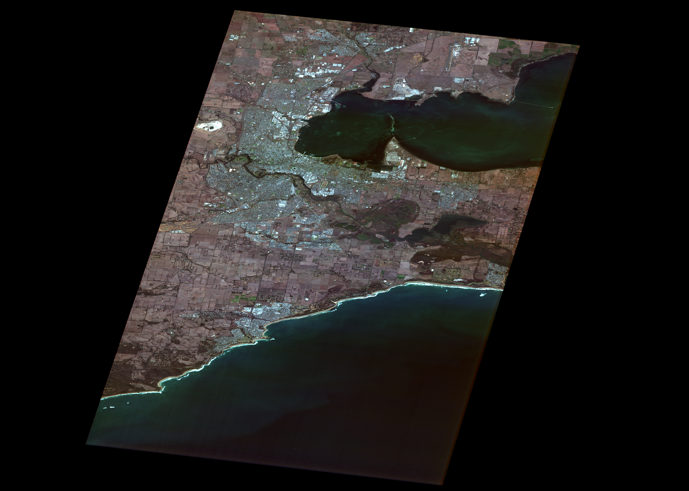
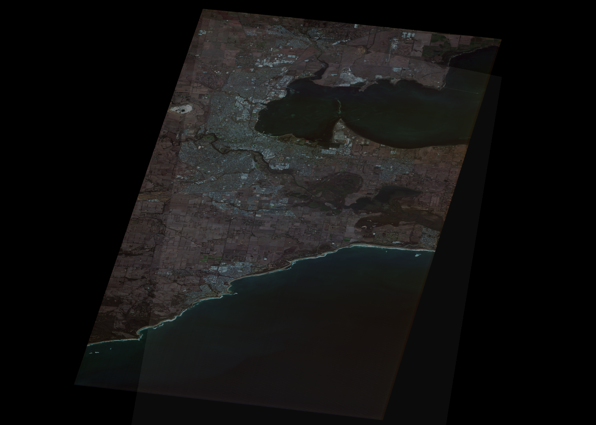
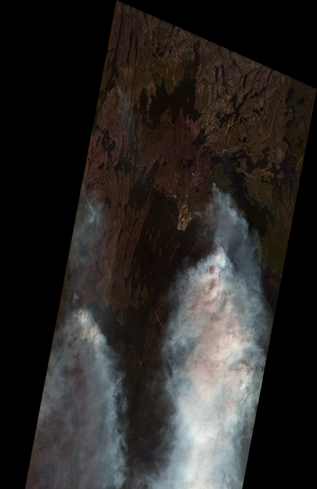
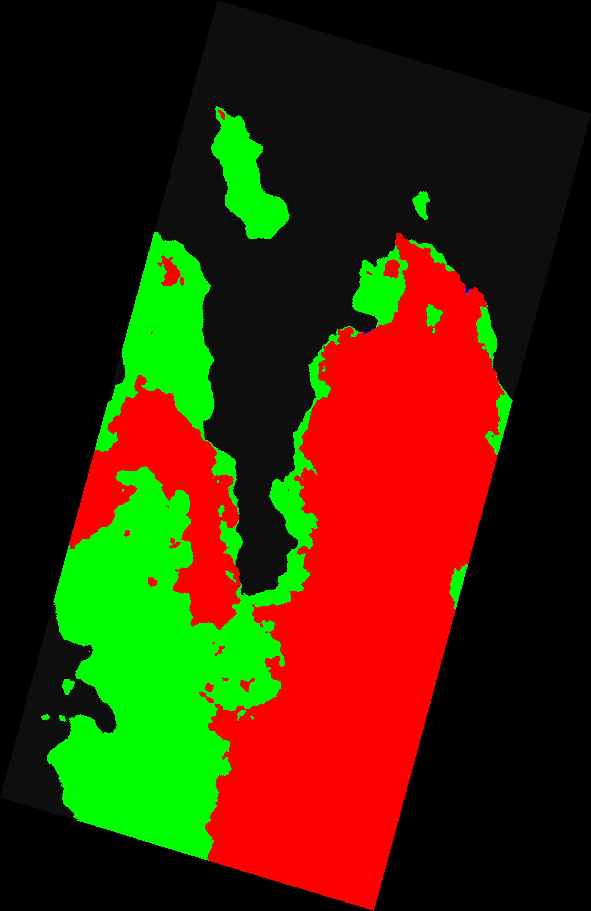
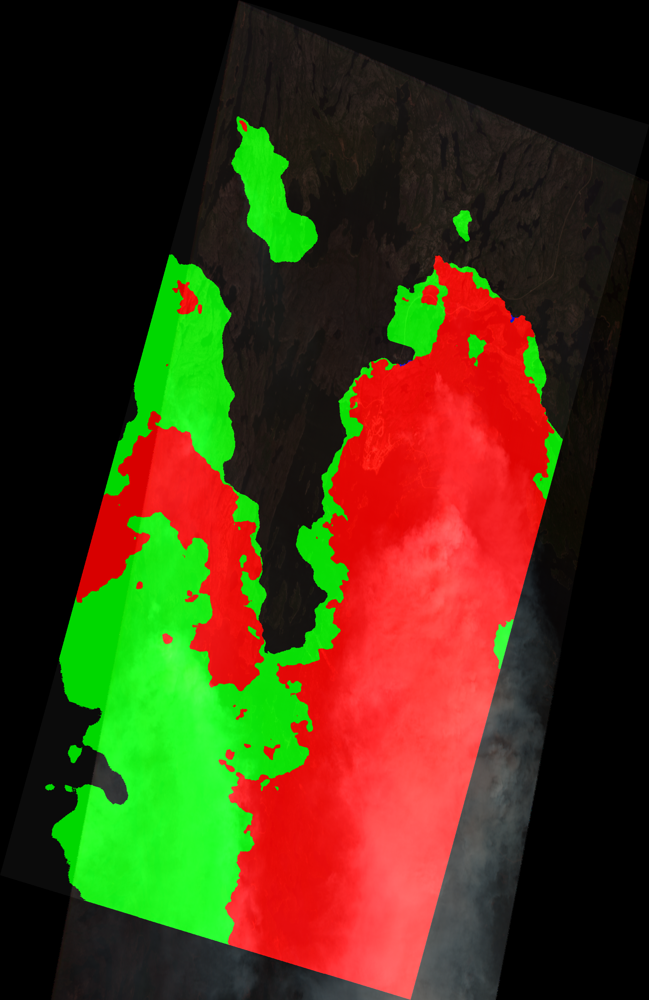
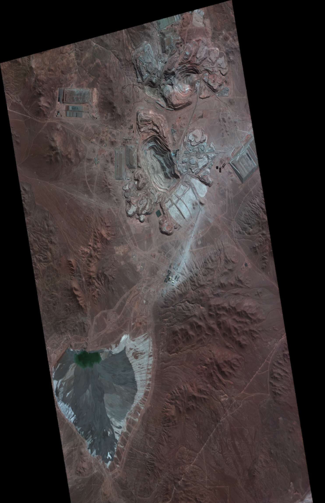
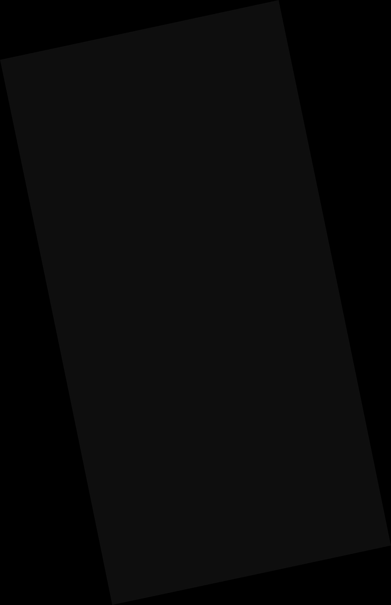
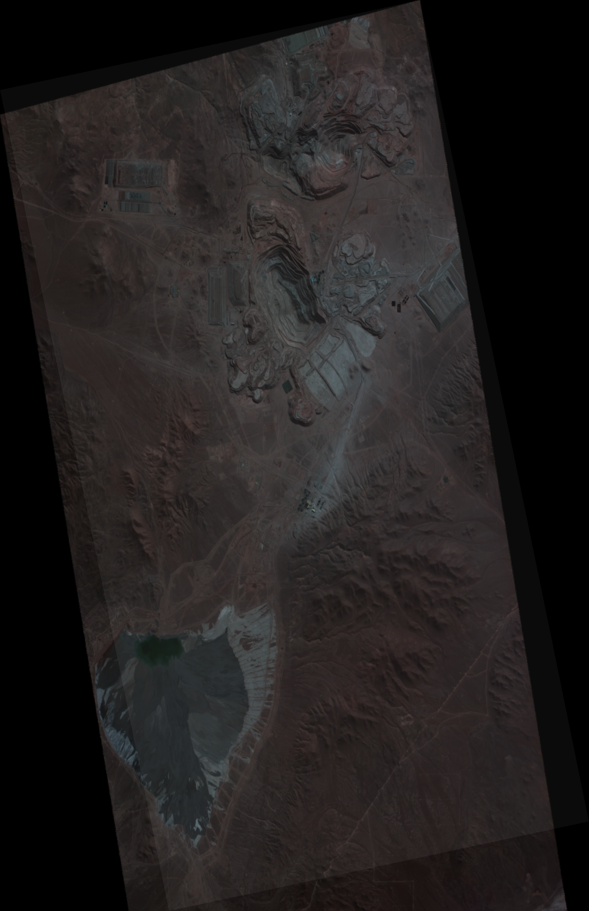

# Pipeline walkthrough — what actually happens to a Wyvern scene

This doc walks each of the three real scenes through the QA pipeline, showing
**raw input → quality mask → processed output → agent decision**, annotated
against the rules in [`prd/qa-qc-prd.md`](../prd/qa-qc-prd.md). Everything
below is computed from the delivered artifacts in [`data/`](../data/) — the
decisions are the agent's actual output in
[`agent/decisions.json`](../agent/decisions.json).

Mask color key used in every figure (same convention as Wyvern's own
visualization):

- **red** = cloud, **green** = haze/smoke, **blue** = cloud-shadow
- dark = clear, black = outside the scene footprint (NoData)

---

## Scene 1 — Clean crop field, Victoria (Australia)

`wyvern_dragonette-003_20250319T000402_d5ebab06_l2a` · Dragonette-003 · 31 bands · L2A · 2025-03-19 · cloud-free

| | |
|---|---|
| **Raw input → L2A preview** |  |
| **Quality mask** |  |
| **Mask over preview** |  |

**What the mask is flagging:** nothing. 100% of the valid footprint is flagged
`clear`; 0% cloud, 0% haze, 0% cloud-shadow. The pixel quality mask reports
**zero interpolated pixels** across all 31 bands, and it covers 100% of the
scene footprint.

**PRD rules exercised:**

| Rule | Finding | Status |
|---|---|---|
| QA-1 (L1B-gated) | 31/31 bands present (platform-expected) | not applicable at L2A — metric passes |
| QA-2 mask gap | quality mask covers 100% of footprint | pass |
| QA-3 cloud/haze | 0.0% obstruction (threshold 40%) | pass |
| QA-4 (L1B-gated) | 0 interpolated pixels | not applicable at L2A — metric passes |
| QA-5/6/7 | geolocation & reflectance not in catalog/repo inputs | not assessable |

**Agent decision: `pass` — CLEAN.** Delivery ready at v1.

---

## Scene 2 — Wildfire smoke, northern Saskatchewan (Canada)

`wyvern_dragonette-003_20250531T173810_56fca26e_l2a` · Dragonette-003 · 31 bands · L2A · 2025-05-31 · 37.85% STAC cloud cover

Captured during the late-May-2025 northern Saskatchewan wildfire complex
(La Ronge region was under air-quality warnings for smoke at the time — e.g.
[CBC](https://www.cbc.ca/news/canada/saskatchewan/la-ronge-indian-band-smoke-air-quality-warning-1.7549014),
[The Weather Network](https://www.theweathernetwork.com/en/news/nature/outdoors/la-ronge-blanketed-in-smoke-as-wildfires-rage-across-northern-saskatchewan)).

| | |
|---|---|
| **Raw input → L2A preview** |  |
| **Quality mask** |  |
| **Mask over preview** |  |

**What the mask is flagging:** heavy atmospheric obstruction. Among valid
pixels: **37.85% cloud** (red) + **24.45% haze/smoke** (green) =
**62.3% cloud-or-haze**, leaving only 37.7% clear. The green haze band is the
smoke — a wildfire scene's "cloud mask" flags smoke as an obstruction because
it blocks the surface signal just like cloud. Only 0.01% is cloud-shadow.

**The subtle bit:** Wyvern's STAC metadata says `eo:cloud_cover = 37.85%` —
*under* the PRD's 40% threshold. The mask tells the real story: cloud **and
smoke** together obstruct 62.3% of the scene, which is what triggers QA-3.
This is exactly why the pipeline layer reads the mask rather than trusting the
catalog summary — metadata alone would have let this scene through.

**PRD rules exercised:**

| Rule | Finding | Status |
|---|---|---|
| QA-2 mask gap | quality mask covers 100% of footprint | pass |
| QA-3 cloud/haze | **62.3% > 40%** → CLOUD | **fail → retry** |
| QA-4/QA-1 | 0 interpolated pixels; 31/31 bands | not applicable at L2A — metrics pass |
| QA-5/6/7 | geolocation & reflectance not in catalog/repo inputs | not assessable |

**Agent decision: `retry` — CLOUD (QA-3).** Retry count → 1, version held at
v1, not delivery ready. Per PRD §3/§4 the obstruction (62.3%) is under the
80% re-task line, so the pipeline re-runs/re-tasks rather than escalates; if
the re-task also fails twice more, the retry ceiling forces escalation.

---

## Scene 3 — Open-pit copper mine, Atacama Desert (Chile)

`wyvern_dragonette-001_20240620T145630_2d5d0eef_l2a` · Dragonette-001 · **23 bands** · L2A · 2024-06-20 · cloud-free

| | |
|---|---|
| **Raw input → L2A preview** |  |
| **Quality mask** |  |
| **Mask over preview** |  |

**What the mask is flagging:** essentially nothing — the Atacama is one of the
driest places on Earth. 100% of the valid footprint is `clear`; 0% cloud/haze.
The pixel quality mask flags a tiny **0.0034% interpolated pixels** (28,871 of
~840M band-pixels) — likely scattered bad-pixel compensation, far below the
2% QA-4 threshold.

**PRD rules exercised:**

| Rule | Finding | Status |
|---|---|---|
| QA-2 mask gap | quality mask covers 100% of footprint | pass |
| QA-3 cloud/haze | 0.0% obstruction | pass |
| QA-4 (L1B-gated) | 0.0034% interpolated (< 2%) | not applicable at L2A — metric passes |
| QA-5/6/7 | geolocation & reflectance not in catalog/repo inputs | not assessable |

**Agent decision: `pass` — CLEAN.** Delivery ready at v1.

---

## What the walkthrough teaches (real data vs. PRD assumptions)

1. **"23-band sensor" is platform-specific.** The PRD assumed 23 bands; real
   data shows **Dragonette-001 = 23 bands, Dragonette-002/003/004 = 31 bands**
   (Wyvern spec). The agent therefore checks band count against the
   *platform's* expected count (`agent/rules.json` → `platforms`) — QA-1 in
   the PRD is written as a fixed 23, which real data corrected.
2. **Catalog summary ≠ mask truth.** Scene 2's STAC `eo:cloud_cover` (37.85%)
   understates the obstruction that the delivered mask reveals (62.3% once
   smoke/haze is counted). QA must read the actual product mask.
3. **Not every artifact is in the repo — and the agent says so.** The
   full-resolution band stacks are 2.2–3.1 GB per scene and the ODP host
   doesn't support partial downloads (see [`data/README.md`](../data/README.md)).
   Reflectance-level rules (QA-6/QA-7) and geolocation metrics (QA-5) are
   therefore logged as **not assessable** rather than silently assumed to
   pass — the decision on each scene rests on the rules the real data can
   support, and the trace states exactly which rules were and weren't
   evaluated.

**End-to-end:** for every scene the same flow runs —
`stac_metadata.json + data_mask.tiff + pixel_quality_mask.tiff` → metrics
(`agent/analyze_scene.py`) → rules in PRD order (`agent/qa_rules.py`, rules
from `agent/rules.json`) → decision + reasoning trace (`agent/decisions.json`,
`agent/logs/`) → dashboard (`dashboard/`).
